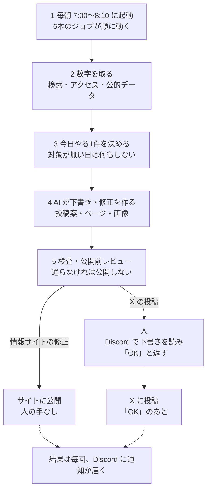

# 自社で運用中の実例

最終更新: 2026-10-12

> ここに載せているのは**受託の実績ではなく**、自分の事業で動かしている仕組みです。何が人の手を通らずに動いていて、人は何をしているかを、2026-10-12 時点の事実で書いています。

## 毎朝動いている仕組みの流れ

流れは2種類あります。情報サイトの修正は、検査とレビューを通ればそのまま公開されます。X の投稿は、人が下書きを読んで「OK」を返したあとにだけ出ます。

## 時点つきの事実（2026-10-12 時点）

### 毎朝、決まった時刻に動く仕事 — 6本

毎朝 7:00〜8:10 のあいだに6本のジョブが順に動きます。ほかに週1回のものが3本、月1回のものが1本。Mac がその時刻に止まっていた日は、起動したあとに未実行の分を1本ずつ追いかけて回します。

### X の投稿は、人の「OK」が承認 — 毎朝 7:00

AI が投稿の下書き2案と添付画像を作り、Discord に届けます。人がやるのは読んで「OK」と返すことだけです。返すと AI がブラウザの画面から投稿し、投稿の URL を記録に残します。2026-08-25 からこの形で回しています。

### 情報サイトの「今日直す1ページ」を機械が決める — 2サイト

検索とアクセスの数字を毎朝取り、前日と比べて、その日に直す1ページを決めたルールで選びます。直す対象が無い日は「様子見」と判定して何もしません。直す日は、AI が直したあと、ビルド・公開前のレビュー・公開まで人の手を通りません。

### 公的データを毎朝取り込むデータベース — 2,793社

上場企業の有価証券報告書から、事業ごとの売上と利益を取り出したデータベースです（2,793社・10,635事業）。毎朝、前日に提出された分を足しています。

### 公表データからページをまとめて作る — 561ページ

国と自治体の公表データの1行から1ページを組み立てる形で、情報サイトを1本作りました（561ページは 2026-09-22 の初回公開時の数）。言えることが少ないページは、データの値で判定して検索に出さない設定にしています。

### App Store に公開した iOS アプリ — 3本

企画から審査の提出、公開後の更新まで1人で通しました。実装は AI エージェントが書き、何を作らないかと、出た物が事実かの確認は私がやっています。

## 役割の分け方

仕組みの中では、役割を持った AI を「実行する役」と「チェックする役」に分けています。作った本人に合格を出させないためです。

つくったアプリや情報サイトの中身は、[つくったもの](04_つくったもの.md)にまとめています。

---

[← README に戻る](../README.md)
